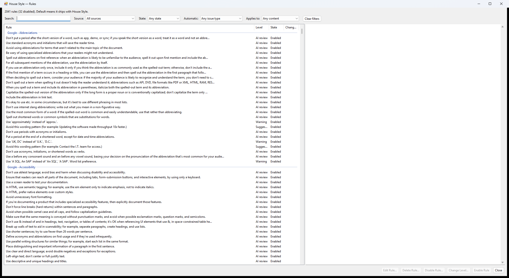

Select **House Style > Rules** to see every rule in one list: Google's, your team's, your own changes, and the open project's. Rules are grouped by source and page.

## Find a rule

Type any word from the rule, its examples or its page in **Search**. Every word must match. To narrow the list, filter by:

- **Source**: Google, Starter rules, your team's guide, your own guide, or the project.
- **State**: enabled, disabled, or at a changed level.
- The type of the rule's issues: **Auto-fix** or **Needs you**.
- The content the rule applies to, such as steps or code.

To start over, select **Clear filters**.

## Read a rule

Select a rule to see its wording, the words it flags and their replacement, its Bad and Good examples, its level, and where it applies. If someone changed the rule, you see who, when and why. Changes that ship with House Style are labeled **Default**.

## Change a rule

- **Edit Rule…**: changes the rule's wording, its words or its examples in your style guide. Use Change Level for its level. Rules from Google and the rules that ship with House Style can't be edited. Disable them instead.
- **Delete Rule…**: removes the rule from your style guide. To stop it for a while and keep it, disable it instead.
- **Disable Rule…**: disables the rule for the team, or for this project only. If other rules flag the same words, you can disable them too.
- **Change Level…**: makes the rule an error, a warning or a suggestion.
- **Enable Rule**: undoes a change. If other rules were disabled with it, you can enable them too.
- **Use the Default**: returns the rule to the way House Style ships it.

Changes apply from your next lint. Disable Rule, Change Level and Enable Rule ask for a reason, so others know why.

If you can't change your team's guide, the buttons say **Request to Disable…**, **Request a Level…** and **Request to Enable…**, and send a request to the style guide owners instead. Edit Rule and Delete Rule are only for people who can change the guide. See [Ask for a rule change](/docs/team-style-guide/ask-for-a-rule-change/).

The window remembers its size.
