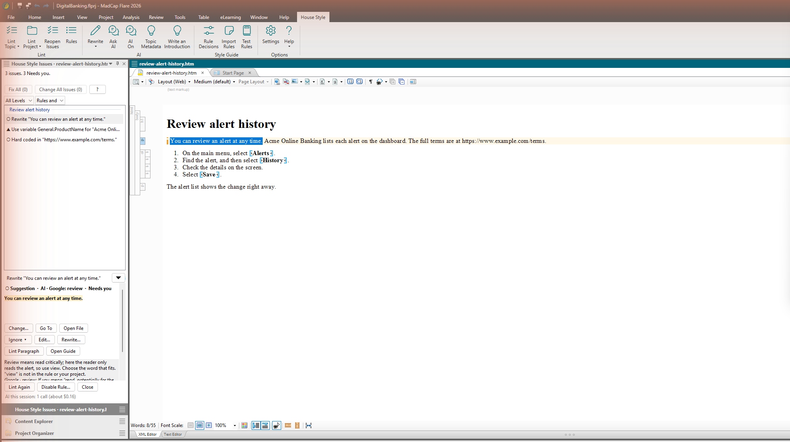
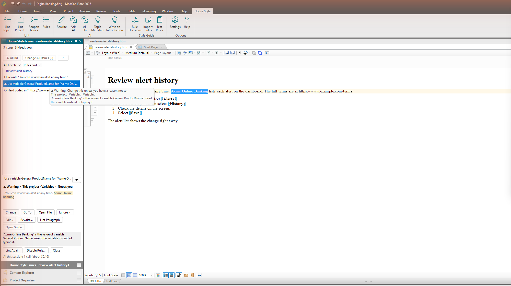
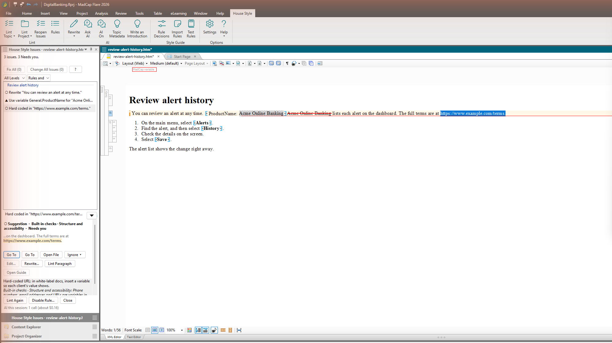

Open a topic and select **House Style > Lint Topic**. With text selected, House Style lints the paragraphs that contain it. With nothing selected, it lints the whole topic.

The issues pane opens. Issues from the style rules appear at once. If you use AI, a wording review follows, paragraph by paragraph. With **No AI** chosen in Settings, the pane says that the AI review is off and shows only the style rules. To stop the AI review, select **Stop AI Review**.

To lint without AI, select the arrow on **Lint Topic** and then **Rules Only**. **Rules and AI Review** adds the AI review. Lint Topic uses the one you chose last until you choose again. If **No AI** is on in Settings, the AI review stays off either way.

## Read an issue

Issues are listed in reading order, under the topic's headings. The line at the top counts them, for example *5 issues in 2 sections. 2 Auto-fix, 3 Needs you.* Select an issue to see:

- **The heading**: its level (Error, Warning or Suggestion), where the rule comes from (Google, Starter rules, Our rules, This project, Built-in checks, or AI), and its type.
- **What changes**: the words around it, with removed words struck through and added words underlined.
- **Why**: the reason, the rule, and the rule's example if it has one.

Each issue has one of two types:

- **Auto-fix**: the rule has an exact fix. **Change** makes it.
- **Needs you**: an AI rewording to check, a variable to insert, or something to fix in the editor, such as a missing alt text.

For text in a snippet, the pane also says how many files use the snippet.

## Decide

| Button | What happens |
|---|---|
| **Change** (Enter) | Makes the change as a tracked change and goes to the next issue. For an issue that needs a rewrite, the button says **Change…**. For a Needs you issue that you fix in the editor, it says **Go To**. |
| **Change All** | Makes the same Auto-fix change for every issue of this rule in the topic. |
| **Ignore ▾** (Delete) | Hides the issue for that text. Choose why: the suggestion is wrong, it's correct in this context, or the rule doesn't apply here. Your reason helps your style guide owners. **Skip for Now** hides it without a reason. **Report False Positive…** tells the House Style team that the rule got it wrong. **Mark as Fixed**, in this menu or when you right-click an issue, marks an issue you've fixed yourself. If the issue is wrong, choose why instead. |
| **Edit…** | Type the replacement yourself. |
| **Rewrite…** | Tell the AI how to change this one issue, for example "keep the term SSO". |
| **Go To** (Ctrl+Enter) | Selects the text in the editor, so you can fix it yourself. |
| **Lint Paragraph** | Lints the paragraph again after you change it in the editor. |
| **Open Guide** | Opens the rule's page in the style guide. |
| **Disable Rule…** | Turns the rule off or changes its level, for the team or for this project. If you can't change your team's guide, the button says **Request Rule Change…**. See [Ask for a rule change](/docs/team-style-guide/ask-for-a-rule-change/). |

When you fix an issue by typing in the editor, it shows as fixed a moment after you stop typing.

Right-click an issue for **Go To**, **Open File**, **Copy File Path** and **Report False Positive…**.

## Change many at once

- **Fix All (n)** makes every Auto-fix change in the topic. One Ctrl+Z undoes them.
- **Change All Issues (n)** makes every change in the topic, including AI rewording, as tracked changes you review in Flare's **Review** tab.

For a missing alt text, **Add Alt Text…** asks the AI to draft it. The AI doesn't change *must*, *should*, *may* or code terms on its own. An issue that would change them is left for you to decide.

## Ignore, exempt and restore

- **Ignore** hides an issue for you. **Ignored Issues (n)** at the top of the pane lists them, and **Restore** brings one back. If the text changed since you ignored it, it shows as *text changed*.
- **Exempt This Text…**, in the **Ignore ▾** menu and the right-click menu, leaves one piece of text out of one rule for everyone on the project. The rule stays on everywhere else. **Exemptions (n)** at the top of the pane lists each one, and **Remove Exemption** shows the issue again. Exemptions are saved in the project, in `Project\HouseStyle\Exemptions.txt`. If your project is under source control, add or check out that file.

## Filter the list

Use the level list (All Levels, Errors, Warnings or Suggestions) and the source list (Rules and AI, Rules Only or AI Only) above the issues to narrow them. **Clear Filters** starts over. The **This Topic** and **Project** tabs switch between the topic you linted and the last Lint Project. In the walk through the issues, press I to ignore and N for the next one.

## Use a variable instead of typed text

When a project variable holds the text you typed, the issue reads *Use variable* and the variable's name, and it is a **Needs you** issue. Select **Change** (or press Enter). House Style selects the text and puts the variable in its place as a tracked change, and then goes to the next issue. If it can't insert the variable, the text stays selected and the pane tells you to select **Insert > Variable** and choose it yourself.

House Style finds a variable when your text has the same letters, capitals included, as the variable's value. The value needs at least three characters and at least one letter. **Edit…** isn't available for these issues.

Phone numbers, email addresses and URLs typed in the text get a suggestion to use a variable too. For those, the button is **Go To**, and you insert the variable yourself.

## Report a false positive

If an issue is wrong, right-click it and select **Report False Positive…**, or select it from the **Ignore ▾** menu. Pick a reason: **The text is correct as written**, **The suggested change is wrong** or **This rule doesn't fit our docs**. A note is optional. House Style sends the rule, the flagged words and your reason. It sends the sentence around them only if you check **Include the surrounding sentence**. The issue stays in the list, so you can still Ignore it.

## Undo and lint again

If you undo a change with Ctrl+Z, or reject it in the **Review** tab, the issue comes back in the pane.

**Lint Again** runs the style rules again and asks the AI for a new review of each paragraph. House Style saves AI reviews, so when you open a topic again, a paragraph you haven't changed shows its saved AI issues, at no cost. When you make a change, **Lint Again** keeps the rest of that paragraph's AI issues instead of asking the AI again.
