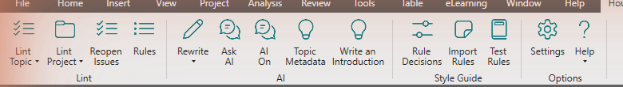

This takes you from a fresh install to your first fixed issue. You need Windows and MadCap Flare 2026.

## 1. Install House Style

Download the zip from the [releases page](https://github.com/abmorrill4/house-style/releases/latest), extract all of it, close Flare, and double-click **Install.cmd**. Approve the administrator prompt. See [Install and update](/docs/get-started/install/) for the details.

## 2. Go through setup

Start Flare. The **House Style** tab is on the ribbon, and a four-step setup opens. You can choose **No AI (style rules only)** and add a key later. Linting works without one, at no cost. See [Set up House Style](/docs/get-started/set-up/).

## 3. Lint a topic

Open a topic and select **House Style > Lint Topic**. The issues pane opens and lists what it found, in reading order.

## 4. Change an issue

Select an issue. The pane shows the words around it with removed words struck through and added words underlined, and a reason. Select **Change**, or press Enter. The change is a Flare tracked change, and the pane moves on to the next issue.

If you disagree with an issue, select **Ignore** and say why. If a rule doesn't fit your docs, select **Disable Rule…**.

## 5. Undo or accept

Press Ctrl+Z to undo a change, and the issue comes back in the pane. To accept or reject your changes together, use Flare's **Review** tab, the same as for a colleague's edits.

## 6. Check the whole project

Select **House Style > Lint Project**. It lints every topic and snippet and sums up the result. Work one rule at a time, and use **Change All…** to make a rule's exact fixes everywhere after you've seen the files. See [Lint a project](/docs/check-your-writing/lint-a-project/).

## What next

- [Lint a topic](/docs/check-your-writing/lint-a-topic/) explains every button in the issues pane.
- [Rewrite text](/docs/ai-assists/rewrite-text/) and [Ask AI as a conversation](/docs/ai-assists/ask-ai-conversation/) use your AI key.
- Style guide owners start with [Set up a team style guide](/docs/team-style-guide/set-up-a-team-style-guide/).
