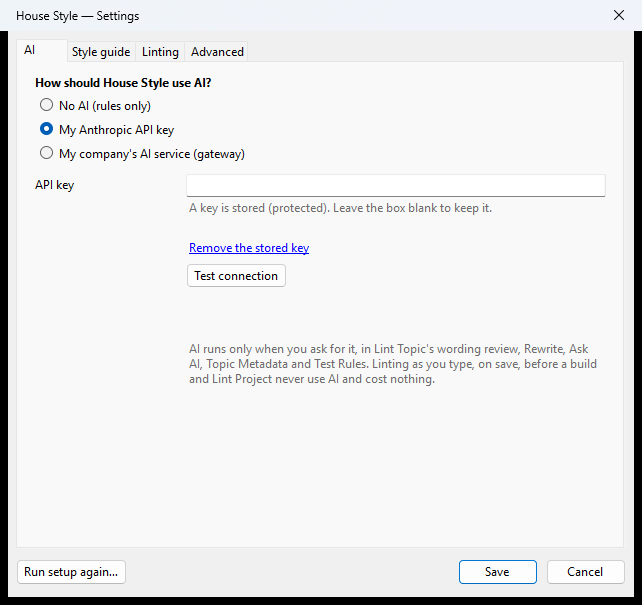
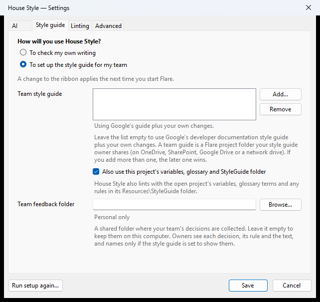

Select **House Style > Settings**. To go through setup again, select **Run setup again…**.

| Tab | What's on it |
|---|---|
| AI | How House Style uses AI, your key, and **Test connection**. |
| Style guide | How you use House Style (a change to the ribbon applies the next time you start Flare), and your team's style guide folder. Leave the folder empty to use Google's guide plus your own changes. Also choose whether to use the open project's variables, glossary and StyleGuide folder, and set the team feedback folder. With a team style guide, your requests to your style guide owners go to that folder too, and the status under it says so. |
| Linting | Linting while you type, when you save, and when a build starts, and the markers in the editor. See [Work in the editor](/docs/check-your-writing/work-in-the-editor/). |
| Advanced | Models (see [Models and cost](/docs/settings-and-privacy/models-and-cost/)), timeout, the diagnostics log, **Send error reports automatically**, Markdown export after each HTML build, automatic updates, and the **Export for LLMs…**, **Diagnostics…**, **Start the Tour Again** and **Report a Problem…** buttons. |

You set your AI key in Settings and nowhere else. House Style stores it encrypted for your Windows account and never shows it again. The box stays empty and says a key is stored. Leave it empty to keep the key, or select **Remove the stored key**. A key set outside Settings, such as in a Windows variable, is not used.

House Style sends a report only when you choose **Send**, or by itself when **Send error reports automatically** is checked. Reports never include your topic text unless you type it in.
