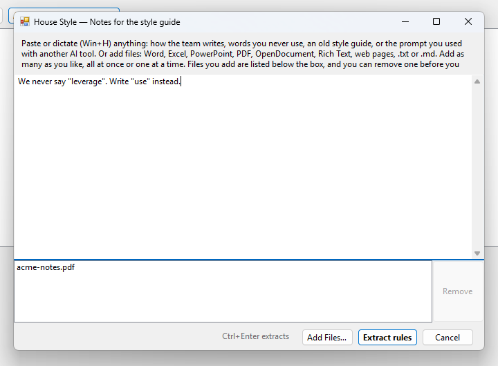
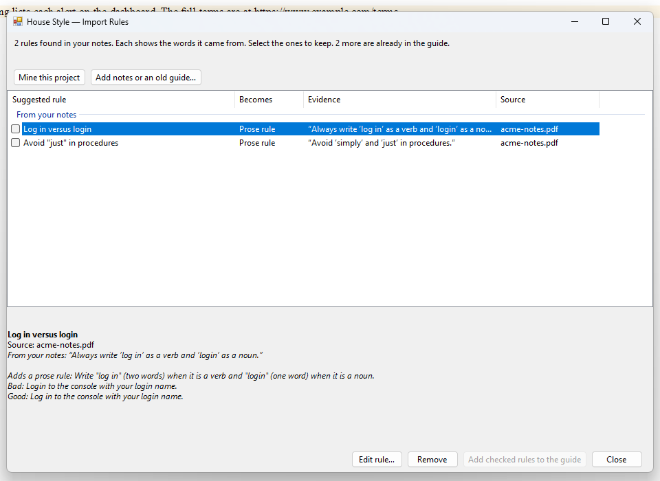

This topic is for style guide owners. Select **House Style > Import Rules** to find rules in what your team already writes, or in a document such as an old style guide. You select the ones to keep, and House Style adds them to your guide.

Writers who aren't owners can open the same window from **My Requests**. For them, the checked rules go to the owners as requests, one per rule, and House Style asks for a reason.

The window has two buttons: **Mine this project** and **Add notes or an old guide…**.

## Mine this project

**Mine this project** reads every topic and snippet in the open project and finds where they disagree, such as competing spellings or terms. It shows counts and example sentences, and you pick the form to keep. It uses no AI and needs no key.

When it finishes, it tells you how many topics it read and how many suggested rules the guide doesn't cover yet. It lists up to 40. If your content already follows the guide, it says so. Files you left out of Lint Project aren't read.

## Add notes or an old guide

Select **Add notes or an old guide…** to open the notes box. Paste or dictate (Win+H) anything: how the team writes, words you never use, an old style guide, or the prompt you used with another AI tool. You can also add files.

1. Select **Add Files…**, and pick as many files as you like. You can add more at any time, all at once or one at a time.
2. Check the list under the box. Each file is listed by name. To drop one, select it and then select **Remove**, or press Delete.
3. Select **Extract rules**. The button is turned off until there is text or a file. Ctrl+Enter does the same.

Pasted text becomes its own source, named *Pasted text*, and isn't in the file list.

### Which files House Style reads

| File | How it is read |
|---|---|
| Word (.docx) | Every paragraph, including table cells. |
| Excel (.xlsx) | Up to 30 sheets, one line per row. |
| PowerPoint (.pptx) | Up to 300 slides. |
| OpenDocument (.odt) | Paragraphs and headings. |
| Rich Text (.rtf) | The text. |
| Web pages (.htm, .html) | The text, without styles and scripts. |
| Text and Markdown (.txt, .md) | As written. |
| PDF | Sent to the AI as a document, so scanned pages and layouts can work too. A PDF can be up to 20 MB. For a larger one, split it, or save only the pages with the rules as a new PDF. |

An older Word file (.doc) or a protected file can't be read. Save it as .docx or as a web page in Word, and add that. If one file can't be read, House Style lists the problem and still loads the others.

Extracting rules uses AI and your key. Long notes cost more, because House Style sends them in pieces. With AI off, it tells you how to turn it on. See [Models and cost](/docs/settings-and-privacy/models-and-cost/).

## Review the suggested rules

Suggested rules are listed in two groups: **From your content** and **From your notes**. The columns are:

| Column | What it shows |
|---|---|
| **Suggested rule** | The rule. |
| **Becomes** | **Avoid/Use row** for a word swap, or **Prose rule** for guidance. |
| **Evidence** | What backs the rule. |
| **Source** | The file a rule from your notes came from, or *Pasted text*. It is empty for rules mined from the project. |

Select a rule to see more, including the words it came from in your notes and up to four examples.

- **Edit rule…** (F2, or double-click) changes its wording, the words to avoid, the replacement, its level or its reason.
- **Remove** (Delete) takes it out of the list. It doesn't touch your guide.
- **Preferred form** appears where your team used two forms. Choose the one to keep.

## Add more later

You can run **Add notes or an old guide…** again and again. Each run adds to the suggested rules, and a rule that is already in the list is left out. If two files hold the same rule, it stays under the first one. Rules your guide already flags are left out too, and the window tells you how many.

## Add the rules to the guide

Check the rules to keep and select **Add checked rules to the guide**. The button shows how many, for example *Add 3 checked rules to the guide*.

House Style writes them into a topic named *From our content* in your guide's `Content/Resources/StyleGuide` folder. It creates the topic the first time. Word swaps go in a table under **Terms**. Prose rules go in a list under **Conventions**, with their Bad and Good examples. The topic opens when it's done, and the added rules leave the list.

Review the topic in Flare and select **Test Rules**. If your guide is under source control, commit it.
